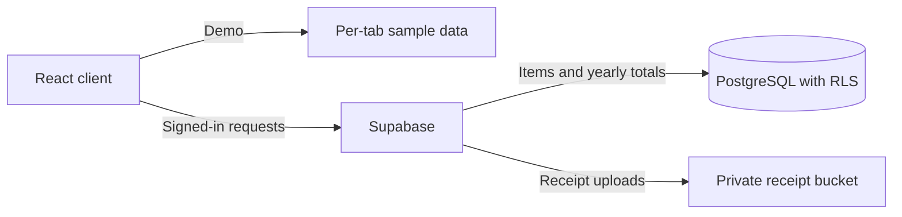
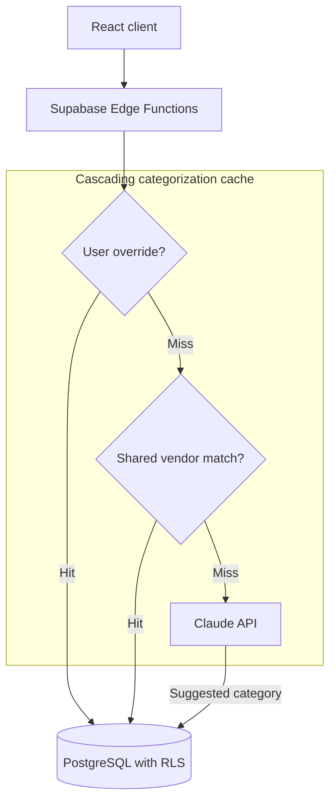

# TaxShoeBox

TaxShoeBox is a solo-built expense tracker for freelancers gathering receipts for Schedule C. Attach a receipt to an expense, assign a category, and review the year’s totals in one place.

## Try it locally

Use Node.js 20, the version in [`.nvmrc`](.nvmrc). The browser demo runs with sample data and no credentials.

```sh
git clone https://github.com/aashwatSingh/TaxShoeBox.git
cd TaxShoeBox
npm ci
npm run dev
```

Open the local address printed in the terminal and choose **Explore the demo**. Note the current year’s expense total, add an expense for that year, and return to the dashboard. The total should increase by the amount you entered. Demo edits stay in the browser tab.

## Architecture

On `main`, React sends signed-in requests to Supabase. PostgreSQL checks row ownership and computes yearly totals with `get_tax_summary`. Receipt files live in a private bucket with per-user access policies. [Tax item queries](src/services/taxService.js) · [Receipt handling](src/services/storageService.js) · [SQL schema](supabase/schema.sql)



<details>
<summary>Design sketch for automatic categorization</summary>

The public app lets the user pick a category. This design sketch shows how an automatic first suggestion could fit into that workflow.



</details>

## Key engineering decisions and trade-offs

- **Give a correction precedence.** In the proposed cache, a user’s category would win even when the shared vendor entry disagrees. A shared hit would save a model call. An unfamiliar vendor would incur both lookups and a Claude request. Vendors that sell several kinds of goods are the reason to keep a personal override.
- **Put ownership in PostgreSQL.** Policies check `auth.uid() = user_id` for tax items and categories. An omitted user filter in a signed-in client query still leaves those policies in force. Receipts need a separate policy because their file paths live in storage. [Table policies](supabase/migrations/20260628120000_init.sql) · [Receipt policies](supabase/migrations/20260628120100_receipts_storage.sql)
- **Make schema changes replayable.** Two timestamped migrations define the setup order. The first creates the tables, policies, and summary function. The second configures receipt storage. Keeping that order in Git makes a fresh database reproducible and lets reviewers spot a change that depends on a manual edit.

## Tech stack

JavaScript and React in the browser. Supabase provides authentication, receipt storage, and PostgreSQL.

## Connect a development database

1. Create a development Supabase project. In its SQL Editor, run the [initial migration](supabase/migrations/20260628120000_init.sql), followed by the [receipt storage migration](supabase/migrations/20260628120100_receipts_storage.sql).
2. Copy the root [`.env.example`](.env.example) to `.env`. Set the project URL and its public anon key. Both values reach the browser.
3. Restart `npm run dev`, create an account, complete the email confirmation if prompted, and sign in. Add an expense and attach a receipt. A second account should see its own records.

### `.env.example`

```dotenv
# Leave both values blank for the browser demo.
VITE_SUPABASE_URL=
VITE_SUPABASE_ANON_KEY=
```

## Screenshots / demo GIF

The local demo includes sample expenses and receipts. Choose **Explore the demo** on the sign-in screen.

<!-- Demo GIF placeholder. Replace this comment with a recording of a sample expense, its attached receipt, and the change in yearly expenses. -->
